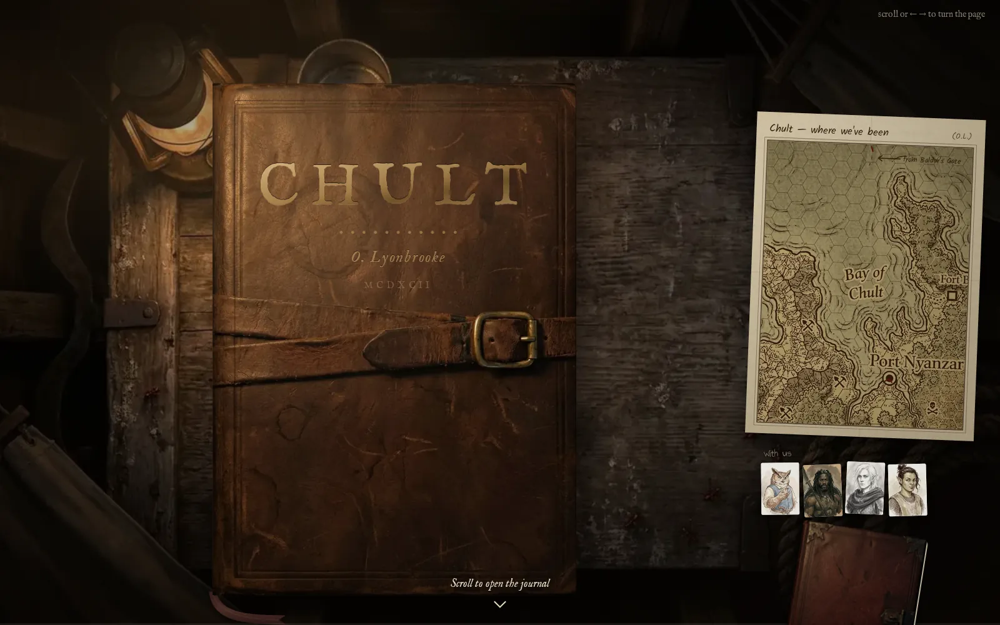
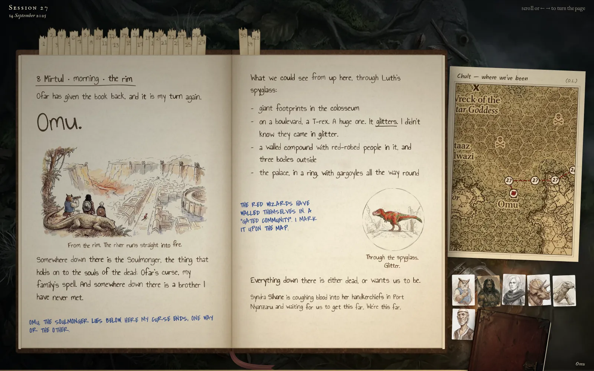
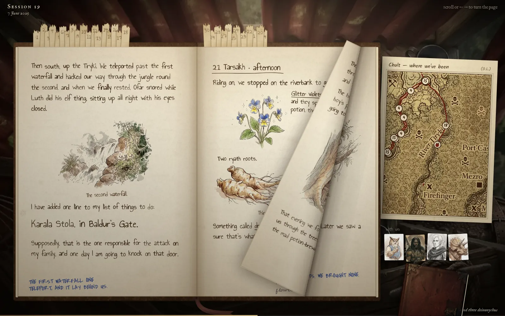
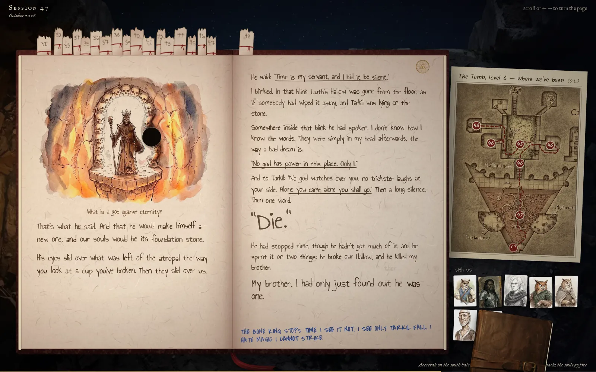

# Oliver's Chult Journal

**Read it at [brutenis.net/chult](https://brutenis.net/chult/).**

This is the journal of Oliver Lyonbrooke, an owlin gunslinger who becomes a necromancer along the way. It covers
forty-eight sessions of a Dungeons & Dragons *Tomb of Annihilation* campaign, played from May 2024 to October 2026, in
two books: 323 pages with 276 ink-and-watercolour pictures. The rest of the party writes in the margins: Ofar in
blue capitals, Luth'ayen in pencil. Now and then a stamp marks a note from the Dungeon Master.

## By the numbers

| | |
|---|---|
| Sessions played | 48, from May 2024 to October 2026 |
| Pages | 323 in two books, about 30,000 words |
| Pictures in the books | 276, plus 23 portraits for the party sidebar and the two covers |
| Pictures generated | 729, to arrive at those 276 (many drafts and corrections per picture) |
| Rounds of revision | about 30: Book I went through 33 published versions, Book II through 24 |
| Feedback from the Dungeon Master | 296 tracked items, 124 of them notes left directly on the pages |
| Human review | 20–30 hours |
| Image generation cost | about $29 |
| Code | about 5,000 lines of JavaScript and CSS, no framework |
| Time | built in about ten days, 27 October to 5 November 2026 |

## How it was made

- The game was played in German. The journal is written in English from the players' notebooks, the Dungeon Master's
  notes and the group chat, with Claude.
- The pictures were made with Google's Nano Banana 2.1 image model from reference portraits of the characters. Each one
  was checked against the session notes and reworked over many rounds of feedback from the Dungeon Master.
- It is plain HTML, CSS and JavaScript with no framework. Each page turn is a paper fold computed frame by frame. The
  map on the desk follows the party's route, and Book II waits at the edge of the desk until you read past the end of
  Book I.

## This repository

This repository holds only the built site: `index.html` and `static/`, where every file is named by a hash of its
content. It is generated from the private campaign repository by `tools/export_web.py`, so don't edit it by hand. Every
push becomes a [release](../../releases/latest) with the site packed as `chult.tar.gz`. The blog
([LiquidFun/brutenis.net](https://github.com/LiquidFun/brutenis.net)) downloads the latest one before it builds and
serves it at `/chult/`.

To read it locally, serve the folder with any static file server, e.g. `python3 -m http.server`, and open
http://localhost:8000/.
